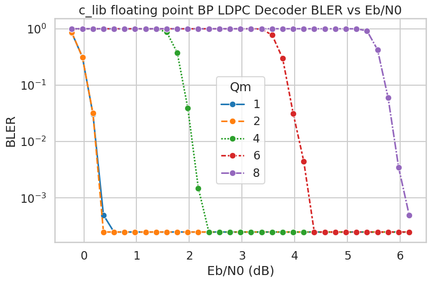
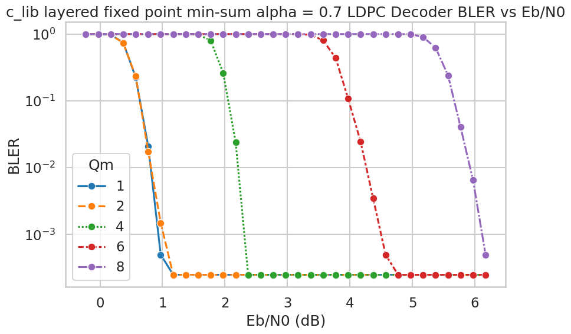
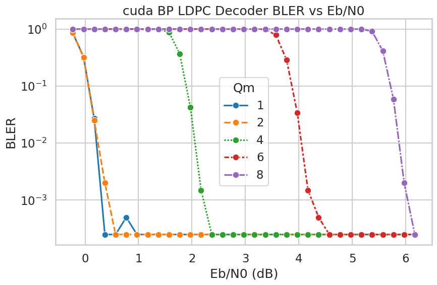
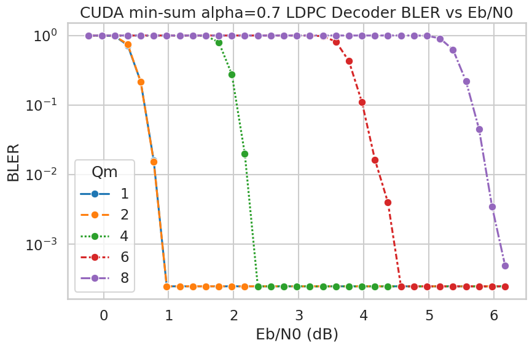

# 深度学习辅助的 5G LDPC 解码器

本仓库实现并评估 5G NR LDPC 编码、速率匹配、信道仿真、速率恢复、解码，以及基于深度学习的解码器参数优化。项目包含三个后端：

- `py5gphy/`：Python 参考实现。
- `c_lib/`：C 语言编码器、信道辅助函数，以及通过共享库暴露的 LDPC 解码器。
- `CUDA/`：用于 GPU 实验的 CUDA 编码器和解码器实现。
- `deep_learning/`：用于学习型 LDPC 解码器参数的训练和评估工具。

项目还包含用于 BLER/BER 扫描的仿真脚本，以及用于训练或评估学习型解码器参数的深度学习工具。

这里的 Python LDPC 实现来自我之前的项目 [`hahaliu2001/python_5gtoolbox.git`](https://github.com/hahaliu2001/python_5gtoolbox.git)。我生成了 60,000 多个测试向量，通过大量仿真验证代码正确性，并确认其符合 5G 标准。

## LDPC 深度学习说明

本项目中的深度学习部分用于离线估计 LDPC 解码器参数，例如 `alpha` 和 `beta`。这些学习得到的参数可以导出为解码器表，也可以用于评估定点或 min-sum 类型的解码器变体。

使用深度学习估计参数后，解码器性能不应预期优于置信传播算法，也就是 BP。BP 是 min-sum 类解码器试图近似的参考算法，因此如果论文或实验结果声称学习型 min-sum 参数可以优于 BP，需要谨慎检查。

## 功能特性

- 基于 TS 38.212 概念的 5G NR LDPC 编码和解码流程。
- 支持 CRC16、CRC24A、CRC24B 和 CRC24C。
- 支持 base graph 1 和 base graph 2 表。
- 支持带调制阶数交织的速率匹配和速率恢复，`Qm = 1, 2, 4, 6, 8`。
- C 解码器变体：
  - 浮点 BP。
  - 定点 min-sum。
  - 训练表 min-sum。
  - 度相关 min-sum。
  - 浮点 min-sum。
- CUDA 解码器变体：
  - 定点 min-sum。
  - 通过 CUDA wrapper 暴露的浮点 BP/min-sum 路径。
- Python、C 和 CUDA 仿真入口都会保存结果 pickle 文件。

## 仓库结构

```text
.
├── py5gphy/                  Python 参考编码器、解码器、CRC、调制和 LDPC 辅助函数
├── c_lib/                    C LDPC 编码器、解码器、信道库和 C 测试
├── CUDA/                     CUDA LDPC 编码器、解码器库和 CUDA 测试
├── scripts/                  BLER/BER 仿真入口
├── deep_learning/            学习型 LDPC 解码器参数的训练和评估工具
├── tables/                   生成的 BG1/BG2 LDPC 表文本文件
├── out/                      仿真结果 pickle 文件
├── deeplearning_out/         保存的训练模型文件
├── test/                     用于 Python/C 一致性检查的 Pytest 测试
└── requirements.txt          Python 环境快照
```

## 开发环境

本项目的开发和测试环境为：

- Ubuntu 24.04 on WSL。
- Python 3.12.3。
- C 后端使用 GCC/Make。
- CUDA 后端使用 NVIDIA CUDA toolkit 13.0，`nvcc` release 13.0, V13.0.88。

## 环境安装

创建并激活虚拟环境：

```bash
python3 -m venv .venv
source .venv/bin/activate
python3 -m pip install --upgrade pip
python3 -m pip install -r requirements.txt
```

如果只运行核心 Python 路径，通常主要需要 `numpy` 和 `scipy`。绘图、notebook、测试、CUDA Python 包和深度学习流程会使用 `requirements.txt` 中更完整的依赖集合。

## 编译

编译 C 共享库和 C 测试程序：

```bash
make -C c_lib
```

该命令会生成：

- `c_lib/libnrLDPC.so`
- `c_lib/test_ldpc_5g_encoder`
- `c_lib/test_ldpc_5g_decoder`

编译 CUDA 共享库和 CUDA 测试程序：

```bash
make -C CUDA
```

该命令会生成：

- `CUDA/libnrLDPC_cuda.so`
- `CUDA/test_ldpc_5g_encoder_cuda`
- `CUDA/test_ldpc_5g_decoder_cuda`
- `CUDA/test_ldpc_encoder_cuda`
- `CUDA/test_nr_crc_cuda`

运行 CUDA 程序需要兼容的 NVIDIA driver 和 CUDA runtime。CUDA 库可能可以编译通过，但如果机器上的 driver/runtime 不匹配，运行时测试仍可能无法执行。

## 运行测试

运行 Python/C 测试：

```bash
python3 -m pytest -q test
```

运行 C 测试程序：

```bash
LD_LIBRARY_PATH=c_lib ./c_lib/test_ldpc_5g_encoder
LD_LIBRARY_PATH=c_lib ./c_lib/test_ldpc_5g_decoder
```

编译 CUDA 后运行 CUDA 测试程序：

```bash
LD_LIBRARY_PATH=CUDA ./CUDA/test_ldpc_5g_encoder_cuda
LD_LIBRARY_PATH=CUDA ./CUDA/test_ldpc_5g_decoder_cuda
LD_LIBRARY_PATH=CUDA ./CUDA/test_ldpc_encoder_cuda
LD_LIBRARY_PATH=CUDA ./CUDA/test_nr_crc_cuda
```

## 运行仿真

仿真脚本位于 `scripts/`。每个脚本顶部定义了 LDPC 参数网格、解码器配置、SNR 范围和 Monte Carlo 测试次数。

运行 C 后端仿真：

```bash
python3 scripts/sim_c_ldpc_encoder_decoder.py
```

运行 CUDA 后端仿真：

```bash
python3 scripts/sim_cuda_ldpc_encoder_decoder.py
```

运行纯 Python 参考仿真：

```bash
python3 scripts/sim_py_ldpc_encoder_decoder.py
```

结果会保存为 `out/` 目录下的 pickle 文件。每个结果文件包含：

- 仿真结果行，
- 解码器配置列表，
- SNR 列表，
- Monte Carlo 测试次数。

共享辅助文件 `scripts/ldpc_c_sim_common.py` 会在长时间仿真开始前检查参数网格组合。不支持的组合会被跳过并给出 warning；如果整个网格都无效，则会抛出 `ValueError`。

## 解码器配置

C 仿真中的解码器配置行格式为：

```text
[algo, max_iterations, alpha, beta, filling_bit_value, max_llr, min_llr]
```

C 解码器算法 ID 为：

```text
0  Floating-point BP
1  Fixed-point min-sum
2  Trained-table min-sum
3  Degree-dependent min-sum
4  Floating-point min-sum
```

`alpha = 22936` 在定点 normalized min-sum 配置中大约表示 `0.7`。

## 深度学习工具

`deep_learning/` 目录包含用于训练和评估学习型 LDPC 解码器参数的脚本和辅助函数。当前保存的模型或结果文件位于 `deeplearning_out/`。

常用入口包括：

```bash
python3 deep_learning/train_single_alpha_ldpc_model.py
python3 deep_learning/train_degree_alpha_ldpc_model.py
python3 deep_learning/train_checkpoint_alpha_ldpc_model.py
```

启动训练任务前，请检查对应脚本中的常量配置，因为训练参数和输出路径是在脚本内部配置的。

## 重新生成 LDPC C 表

`py5gphy/ldpc_c_parameters.py` 包含用于生成 `tables/` 目录下 C 表文本文件的辅助函数，包括 BG1/BG2 HBG index 数组和 shift-value 数组。

需要重新生成表文件时，可以直接运行：

```bash
python3 py5gphy/ldpc_c_parameters.py
```

## 从 Python 调试 C 代码

当通过 `ctypes` 从 Python 调用 C 函数并需要调试时，Linux 可能会阻止调试器 attach。可以在当前会话中执行以下命令允许 GDB attach：

```bash
echo 0 | sudo tee /proc/sys/kernel/yama/ptrace_scope
```

然后：

1. 启动 Python 脚本，并在调用 C 函数前暂停。
2. 打印或查看 Python 进程 ID，例如使用 `os.getpid()`。
3. 在另一个终端中用 GDB attach 到该进程。

## 清理编译产物

清理 C 编译产物：

```bash
make -C c_lib clean
```

清理 CUDA 编译产物：

```bash
make -C CUDA clean
```

## 补充说明

- 在已测试的配置中，C 语言 LDPC 编码器和解码器的执行速度约为 Python 参考实现的 500 倍。

- 在我的实验中，深度学习辅助的 LDPC 解码器参数优化，相比仔细调优的非训练解码器配置，并没有表现出明确的性能优势。

- 许多论文会给出 BER versus Eb/N0 曲线，但对于实际通信系统评估，BLER 通常是更有意义的指标。BER 和 BLER 之间不存在固定的一一对应关系：BLER 还取决于码块长度、错误聚集情况、CRC 检测和解码器行为。

## C-Lib LDPC 解码器性能

以下 BLER 曲线由 `scripts/plot_analysis_c_lib_ldpc_performance.ipynb` 基于 C 后端仿真结果生成。





## CUDA LDPC 解码器性能

以下 BLER 曲线由 `scripts/plot_analysis_cuda_ldpc_performance.ipynb` 基于 CUDA 后端仿真结果生成。





## License

本项目采用 MIT License。详情见 `LICENSE`。
